# ReserveHub

### 회의실 및 상담 통합 예약 관리 시스템

ReserveHub는 회의실 예약과 상담 예약을 하나의 플랫폼에서 관리할 수 있도록 개발한 웹 애플리케이션입니다.

사용자는 원하는 회의실 또는 상담 담당자를 선택하여 예약할 수 있으며, 예약 내역 조회, 수정 및 취소가 가능합니다.

관리자는 회의실과 예약 현황을 관리할 수 있습니다.

## 1. 기술 스택

### Backend
- Java 21
- Spring Boot
- Spring Security
- Spring Data JPA
- MariaDB
- Gradle

### Frontend
- React
- Vite
- JavaScript
- CSS

### Authentication
- JWT (JSON Web Token)
- BCrypt Password Encoder

### Development Tools
- IntelliJ IDEA
- Visual Studio Code
- Postman
- Git / GitHub

## 2. 주요 기능

### 회원 관리
- 회원가입 및 로그인
- JWT 기반 사용자 인증
- BCrypt를 이용한 비밀번호 암호화(해싱)
- 사용자 권한에 따른 접근 제어

### 회의실 예약
- 회의실 목록 조회
- 회의실 및 예약 시간 선택
- 회의실 예약 생성
- 내 예약 목록 조회
- 예약 시간 변경 및 예약 취소
- 동일 시간대 중복 예약 방지

### 상담 예약
- 상담 담당자 목록 조회
- 상담 유형 및 예약 시간 선택
- 상담 예약 생성
- 내 상담 예약 조회
- 상담 예약 수정 및 취소
- 동일 시간대 중복 예약 방지

### 관리자 기능
- 관리자 권한에 따른 메뉴 구분
- 회의실 관리
- 전체 예약 현황 관리

## 3. 프로젝트 화면

### 3.1 메인 화면
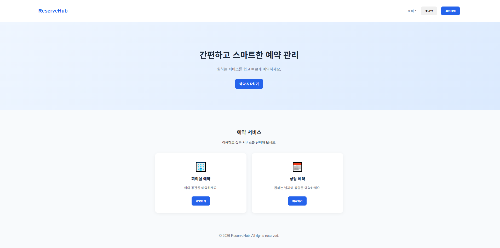

### 3.2 회원가입 및 로그인
**회원가입**
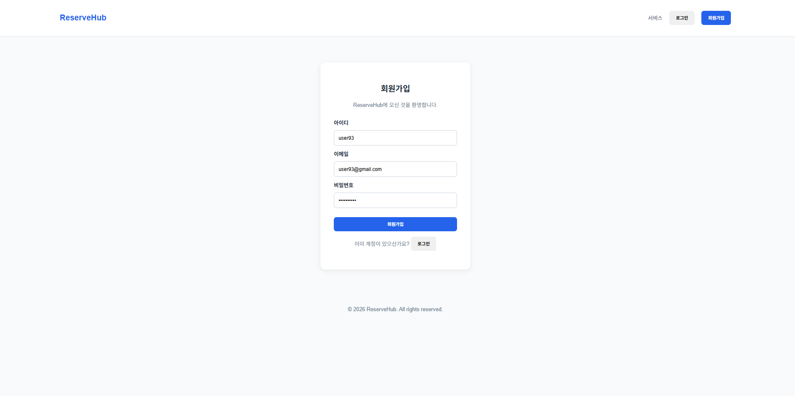

**로그인**
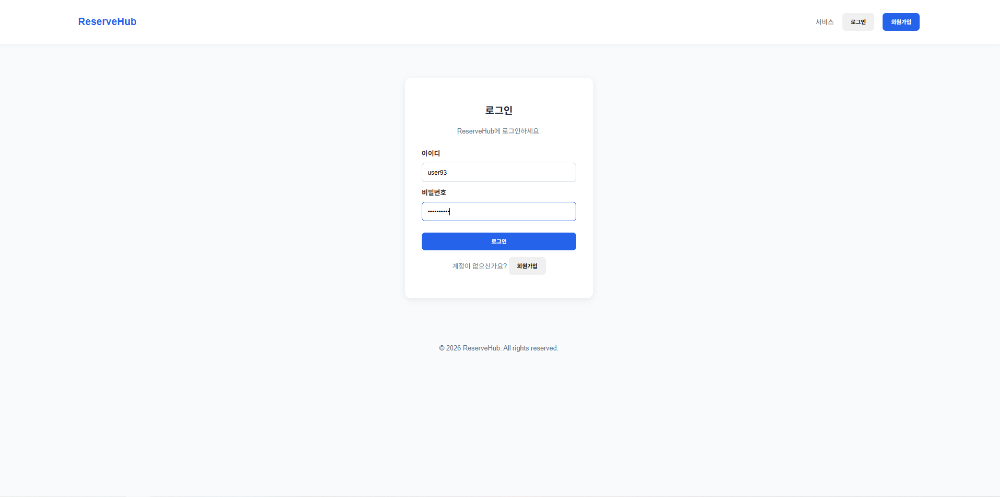

### 3.3 회의실 예약
**회의실 예약**
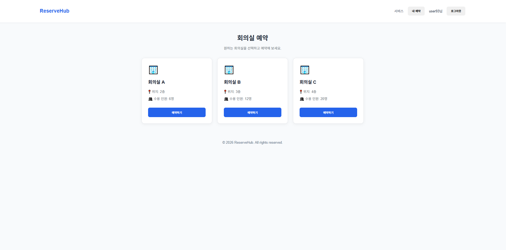

**예약 확인**
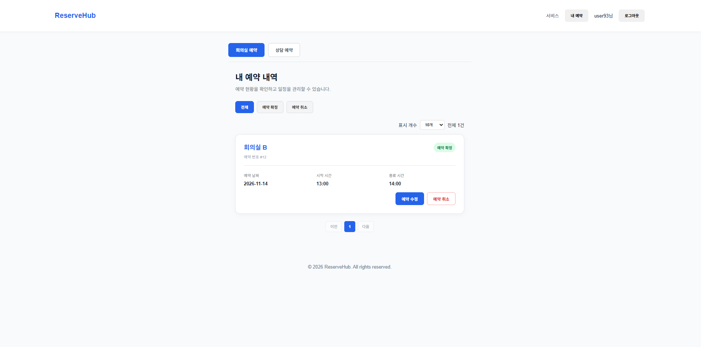

**예약 시간 변경**
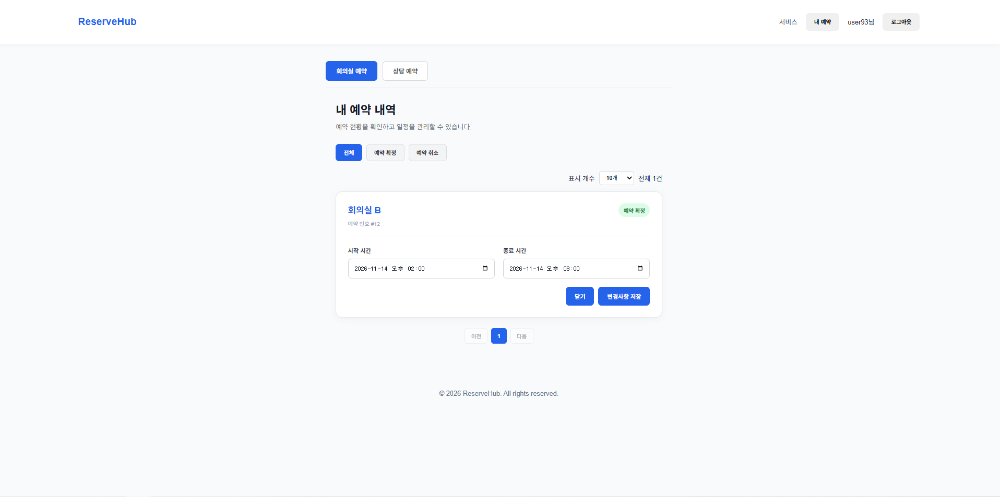

**예약 시간 변경 완료**

**예약 취소**
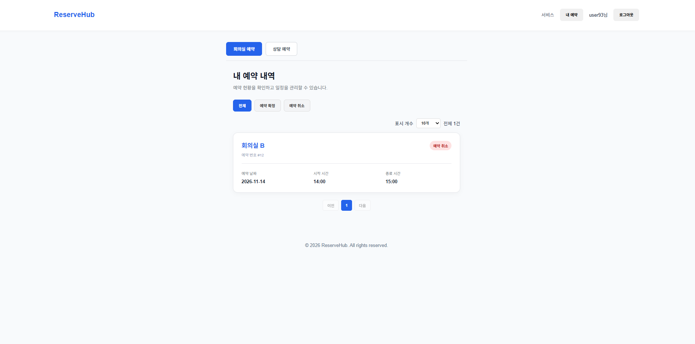

### 3.4 상담 예약
**상담 예약**
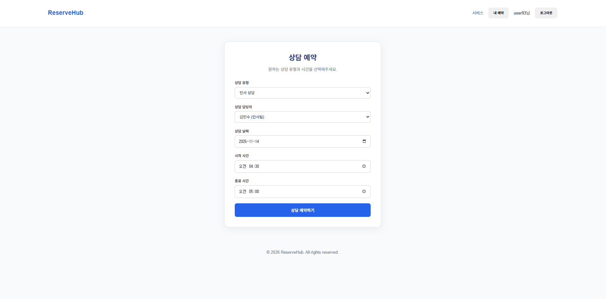

**상담 예약 확인**
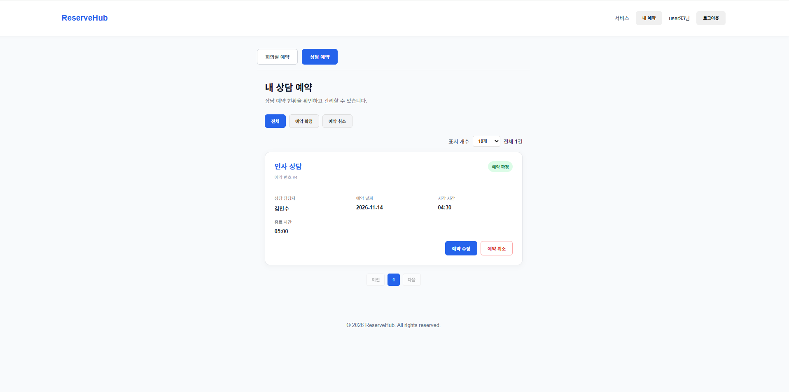

**회의실 등록**
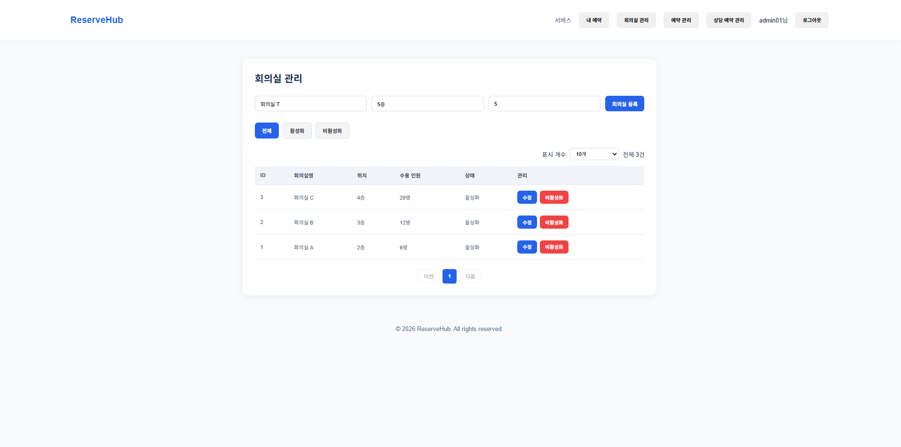

**전체 예약 내역**
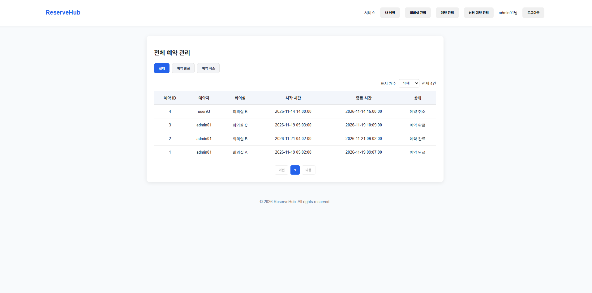

**회의실 수정**
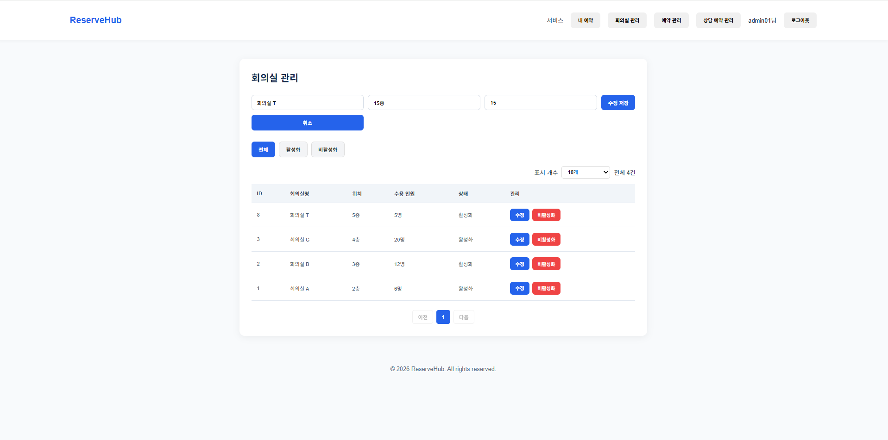

## 4. 데이터베이스 설계 (ERD)

ReserveHub는 총 5개의 테이블로 구성되어 있으며,
사용자와 회의실 예약, 상담 예약 간의 관계를 외래 키로 관리합니다.

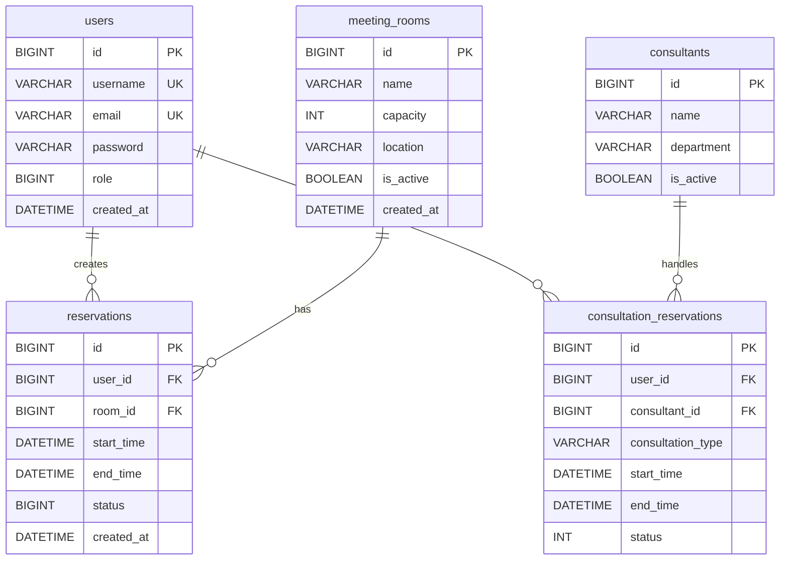

### 테이블 설명

| 테이블 | 설명 |
|---|---|
| users | 회원 정보 및 권한 관리 |
| meeting_rooms | 회의실 정보 및 활성화 상태 관리 |
| reservations | 회의실 예약 정보 관리 |
| consultants | 상담 담당자 정보 관리 |
| consultation_reservations | 상담 예약 정보 관리 |

### 데이터 무결성

- PK와 FK를 활용한 테이블 관계 설정
- 회원 아이디 및 이메일 UNIQUE 제약조건
- 회의실 수용 인원 CHECK 제약조건
- 회의실 예약 종료 시간이 시작 시간보다 늦도록 CHECK 제약조건
- 서비스 계층에서 예약 시간 중복 검사

